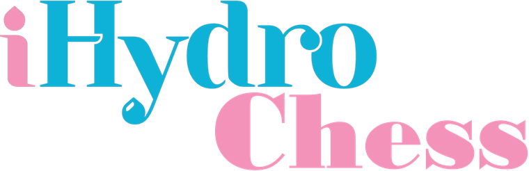

<h1 align="center"></h1>

Chess puzzles from real grandmaster games, tied to real expert replies in a modelling forum. Solve the chess; every correct move reveals the matching move of the expert's reply and what it teaches about SWAT-MODFLOW.

**Open `index.html`** in any browser. It is a single self-contained file: no install, no server, it works offline (the font stylesheet is the only external request, and the page falls back to system fonts without it).

Live page, once published with GitHub Pages: `https://dauresy.github.io/chess/` (repository `dauresy/chess`)

## What a puzzle is

Thirty-seven stretches of real games (FIDE World Championship 2021 and 2023, Candidates 2024, Norway Chess 2024, Tata Steel Masters 2025). Each one is tied to a real first reply of the SWAT-MODFLOW Google group owner to a question from the group:

* the number of moves of the puzzle is the number of moves of the reply;
* the pieces that move are the cost of each move to the person who asked: pawn 0 read, knight 1 look, bishop 2 try, rook 3 answer one thing, queen 4 send a file, king or castling 5 send the project; a move with no cost of its own (a courtesy, a condition, a hedge, the promise to look) is a free move, any piece;
* White to play means the reply needed at most L2 (look it up or recognise the case); Black means L3 (weigh the evidence);
* a direct reply is the end of a decisive game (the loser resigns); a reply that asks for something is a stretch of the middle of a game, left open; a direct reply for which no game ends in the right way is shown as a stretch of the middle of a game too (group "Resolved, mid-game": the case is resolved, but nobody resigns).

The page opens on three steps that are always in view: a topic (seven tiles, such as calibration and method, crashes when running or plug-in bugs, each with its number of questions and a bar of the move families experts use there, in the colours of the paper figures), how many moves to play (2, 3, 4 or 5 or more) and the question (or "Surprise me"). The counts update as you choose, and a slim bar stays on screen to change the question. You do not need to know hydrology: the statement ("Black to play. White resigns in 3 moves") and the clue (which pieces move, in order) are enough to find the grandmaster's moves. Afterwards each move shows its piece, the colour of its knowledge level, its place on the cost ladder, what it does and when the expert uses it, with a takeaway for the hydrology.

## Publish with GitHub Pages

1. Create the repository and upload these files (keep `index.html` at the top level).
2. Settings, Pages, "Deploy from a branch", branch `main`, folder `/ (root)`, Save.
3. Wait a minute; the page is at the address above.

## Rebuild or extend

```
source/
  build_page.py     builds index.html from data/ (standard library only)
  gen_puzzles.py    makes data/puzzles.json from PGN files (needs: pip install chess)
  template.html     the page
  gloss.js          one line for each of the 42 moves
  data/             moves.json, replies.json, puzzles.json, matches.json, takeaways.json
  vendor/           chess.js 0.10.3 and its licence
```

```bash
python source/build_page.py                                  # rebuild index.html
python source/gen_puzzles.py --pgn-dir PATH_TO_PGN_FOLDER    # new puzzles from your own games, then build again
```

`gen_puzzles.py` reads every `*.pgn` under the folder in sorted order with a fixed random seed, so the same games give the same puzzles. The published puzzles came from 349 games of the events above. The list `CURATED` is the choice of replies, made for what they teach. The takeaways in `data/takeaways.json` were written from the paraphrased replies only; they are the author's own wording.

## Data and credits

* Games: official FIDE event broadcasts as published on Lichess (https://lichess.org). Players, ratings, venues, dates and the link to each full game come from the game records. Each rating is the one on the date of that game. This project has no relation to FIDE, Lichess or the players, and nothing in it is a judgement on how anyone played. Chess moves are facts; check Lichess's terms if you redistribute the PGN files themselves.
* Replies: first replies of the SWAT-MODFLOW group owner, who is a co-author of this project (declared here because they are both the expert studied and an author), coded with a 42-move codebook by one author and paraphrased; names, thread identifiers and links are left out. The knowledge levels (L1 to L3) and the cost rungs are assigned by the author, not measured.
* Comparison with other communities: `source/data/communities.json` gives, for each of the 42 moves, the number of first replies that contain it in SWAT-MODFLOW (57 replies read), SWAT (55), MODFLOW (60) and APEX (56), with a 95% Wilson interval. The four are coded with the same 42 moves by one coder; the puzzles come only from SWAT-MODFLOW. The numbers are those of the companion paper's data (heatmap of moves by community).
* Chess rules in the browser: chess.js 0.10.3, BSD-2-Clause, Copyright (c) Jeff Hlywa, https://github.com/jhlywa/chess.js (included in `index.html`; licence in `source/vendor/`).
* Fonts: IBM Plex Mono from Google Fonts (SIL Open Font License); the rest of the text uses the system sans-serif font, as iHydro Check does.

## Look and logo

The page follows the look of iHydro Check (black background, the same colours and the same hero). The logo "iHydro Chess" is the iHydro Check logo with the word Check replaced by Chess; the new word is set in Bodoni MT Black, which only approximates the lettering of the original (`source/assets/`: the full-size logo, the 760 px copy that is inlined in the page, and the favicon). Replace these files with the artwork of the iHydro family if it is available and run `python source/build_page.py`.

## Anonymous copy for blind review

`python source/build_page.py --anonymous` writes `index_anonymous.html`: no logo, no brand name, no favicon and no co-author statement. Put the DOI in only after acceptance.

## Limits

* No engine checks the moves. A puzzle accepts the move the grandmaster played; another move can be as good.
* The match between a reply and a stretch of a game shows that the code can be read, not that chess and help threads work alike.
* One expert, one group, one coder. This page illustrates a study; it is not a result.
* Puzzle progress stays in the visitor's browser (local storage).

## Licence

* Code (`index.html` apart from the chess library, and everything in `source/` that is code): MIT, see `LICENSE`.
* Text and data written for this project (paraphrased replies, takeaways, descriptions of the moves, `source/data/`): CC BY 4.0, credit the authors listed in `CITATION.cff`.
* Not covered: the iHydro and iHydro Chess logos and the favicon (`source/assets/`), which belong to their owners and are used here with the page's look; replace them in a fork. Also not covered: chess.js (BSD-2-Clause, `source/vendor/LICENSE-chess.js.txt`) and the game records, which are facts about public events taken from official broadcasts.

## How to cite

See `CITATION.cff` (GitHub shows a "Cite this repository" button). After the first release on Zenodo, add the DOI there and here.
